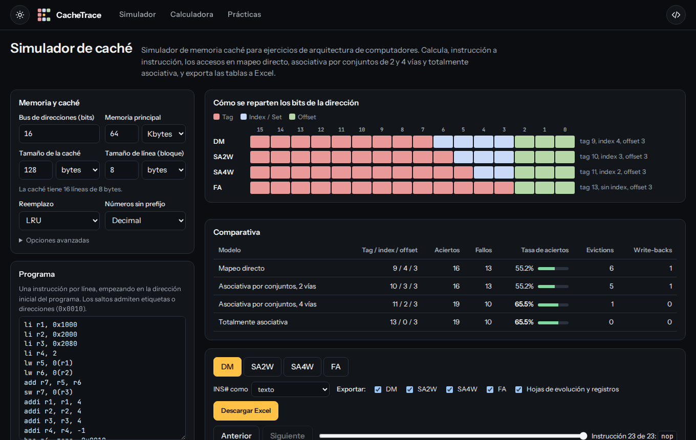
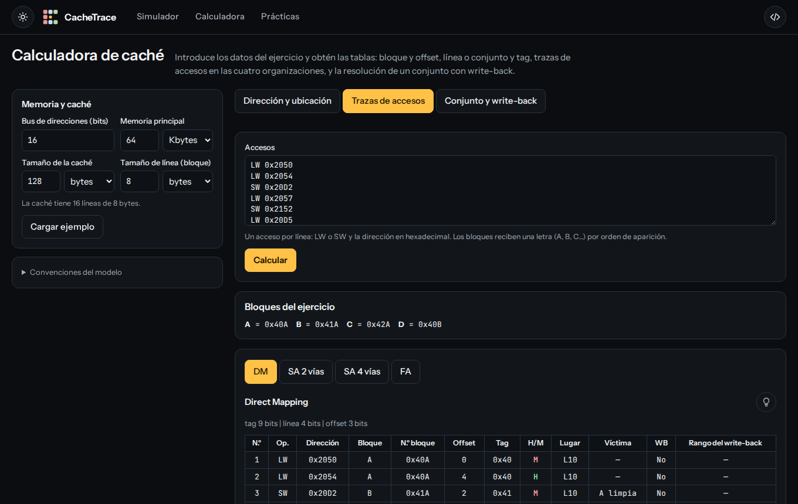
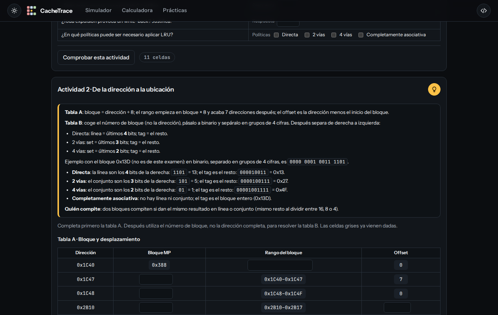

# CacheTrace

**Cache memory toolkit for computer architecture courses: a simulator with Excel export, an exercise calculator and graded practice exams for direct-mapped, 2-way, 4-way and fully associative caches.**

**Herramientas de memoria caché para arquitectura de computadores: simulador con exportación a Excel, calculadora de ejercicios y exámenes de práctica con corrección para mapeo directo, 2 vías, 4 vías y totalmente asociativa.**

[](https://github.com/FACIIAN/cachetrace/actions/workflows/pages.yml) [](LICENSE)

[Web](https://faciian.github.io/cachetrace/) · [Simulator / Simulador](https://faciian.github.io/cachetrace/simulador/) · [Calculator / Calculadora](https://faciian.github.io/cachetrace/calculadora/) · [Practice / Prácticas](https://faciian.github.io/cachetrace/practicas/) · [English guide](docs/guide.en.md) · [Guía en español](docs/guide.es.md)

English | [Español](#español)



## English

CacheTrace has three tools that share the same rules and run entirely in your browser (no server, no account, nothing leaves your computer):

| Tool | What it does |
| --- | --- |
| **Simulator** | Runs a small RISC-style program (`li`, `lw`, `sw`, `lb`, `sb`, `addi`, `bne`…) and replays every Fetch and Execute on four cache organizations at once. Hit or miss, eviction and write-back per access; cache and registers step by step; Excel export with formulas. |
| **Calculator** | Takes the data of an exercise and solves the tables: block, offset and range of an address; line or set and tag; blocks that compete; access traces (`LW`/`SW`) on the four organizations; comparison between policies; and a set with an initial state resolved with write-back. |
| **Practice** | Three exams (easy, intermediate, hard) with ten activities each. Lightbulb hints, tolerant grading (`0x204` = `0X204`) with green and red cells, and a downloadable PDF with the solution. |

The website is bilingual (Spanish and English) and has a light and a dark theme. The tools' interface is currently in Spanish.



### Highlights

- Direct-mapped, 2-way (SA2W), 4-way (SA4W) and fully associative (FA) caches for the same program or the same list of accesses.
- Bit split derived from the address bus, the cache size and the block size, with fixed colours: tag, index and offset.
- Memory, cache and block sizes entered as a number and a unit (bytes, Kbytes, Mbytes, Gbytes).
- Write-back with write-allocate; LRU or FIFO in the simulator; invalid lines are filled in order.
- Byte, half-word and word accesses; little-endian memory dumps byte by byte.
- Practice exams generated with the same verified engine: every answer is computed, never typed by hand.



### Practice exams

Each exam contains the same activity types: diagnostics, from address to placement (tables A and B), the four variants (A to D), comparison between policies, find the error, write and write-back, and a final test. The easy exam uses the usual configuration with many given cells; the hard one changes the parameters (bus, block size) and gives almost nothing. Press *Check* to see which cells are right; open the lightbulb of an activity for the method; download the PDF when you finish.

### Use

Open the [website](https://faciian.github.io/cachetrace/) and pick a tool. Nothing needs to be installed. To run it from source, see [Development](#development).

### Conventions and limitations

CacheTrace always applies the same rules: unified cache, initially empty unless an initial state is given; write-back with write-allocate; LRU, taking invalid lines first in ascending order; 32-bit words in little-endian. It models a fixed write policy and it is a study tool: check the results against your own problem statement. See the [technical guide](docs/guide.en.md) for the details.

### Development

Requires Node.js 20 or later.

```bash
npm ci          # install development dependencies
npm test        # tests, including a cross-check against an independent reference model
npm run build   # generate ./dist (website, tools and PDF solutions)
npm start       # serve ./dist at http://localhost:8080
```

| Path | Contents |
| --- | --- |
| `src/engine.js` | Parser, functional CPU, cache models and Excel workbook builder of the simulator. |
| `src/blockmodel.js` | Block-level model used by the calculator and the exams (placement, traces, set resolution). |
| `src/exams.js`, `src/checker.js`, `src/hints.js` | Exam data and solutions, tolerant answer checker and hints. |
| `src/pdf.js` | PDF solutions, generated when the site is built. |
| `src/*.template.html`, `src/shared/` | Pages of the three tools and the code they share (theme, top bar, hint button, size fields). |
| `website/` | Landing page template, styles and texts (`i18n/es.json`, `i18n/en.json`). |
| `tests/` | Tests, including an independent reference cache model. |

The engines have no DOM code, so they can be tested from Node. Every change to the cache behaviour should come with a test.

- [Changelog](CHANGELOG.md)
- [License](LICENSE) · [Third-party notices](THIRD_PARTY_NOTICES.md)

---

[English](#english) | Español

## Español

CacheTrace reúne tres herramientas que comparten las mismas reglas y se ejecutan por completo en tu navegador (sin servidor, sin cuentas y sin que nada salga de tu ordenador):

| Herramienta | Qué hace |
| --- | --- |
| **Simulador** | Ejecuta un programa tipo RISC (`li`, `lw`, `sw`, `lb`, `sb`, `addi`, `bne`…) y reproduce cada Fetch y Execute en cuatro organizaciones de caché a la vez. Hit o miss, expulsión y write-back por acceso; estado de la caché y de los registros paso a paso; exportación a Excel con fórmulas. |
| **Calculadora** | Toma los datos de un ejercicio y resuelve las tablas: bloque, offset y rango de una dirección; línea o conjunto y tag; bloques que compiten; trazas de accesos (`LW`/`SW`) en las cuatro organizaciones; comparación entre políticas; y un conjunto con estado inicial resuelto con write-back. |
| **Prácticas** | Tres exámenes (fácil, intermedio y difícil) con diez actividades cada uno. Pistas con una bombilla, corrección tolerante (`0x204` = `0X204`) con celdas en verde y rojo, y la solución descargable en PDF. |

La web es bilingüe (español e inglés) y tiene tema claro y oscuro. La interfaz de las herramientas está por ahora en español.

### Funciones principales

- Mapeo directo, asociativa de 2 vías (SA2W), de 4 vías (SA4W) y totalmente asociativa (FA) para el mismo programa o la misma lista de accesos.
- Reparto de bits calculado a partir del bus, el tamaño de la caché y el del bloque, con colores fijos: tag, index y offset.
- Tamaños de memoria, caché y bloque con número y unidad (bytes, Kbytes, Mbytes, Gbytes).
- Write-back con write-allocate; LRU o FIFO en el simulador; las líneas inválidas se ocupan por orden.
- Accesos de byte, media palabra y palabra; dumps de memoria byte a byte en little-endian.
- Exámenes de práctica generados con el mismo motor verificado: cada respuesta se calcula, no se escribe a mano.

### Exámenes de práctica

Cada examen tiene los mismos tipos de actividad: diagnóstico, de la dirección a la ubicación (tablas A y B), las cuatro variantes (A a D), comparación entre políticas, encuentra el error, escritura y write-back, y prueba final. El fácil usa la configuración habitual con muchas celdas dadas; el difícil cambia los parámetros (bus y tamaño de bloque) y casi no da nada. Pulsa *Comprobar* para ver qué celdas están bien; abre la bombilla de una actividad para ver el método; descarga el PDF al terminar.

### Uso

Abre la [web](https://faciian.github.io/cachetrace/) y elige una herramienta. No hay que instalar nada. Para ejecutarla desde el código, consulta [Desarrollo](#desarrollo).

### Convenciones y limitaciones

CacheTrace aplica siempre las mismas reglas: caché unificada, inicialmente vacía salvo que se indique un estado inicial; write-back con write-allocate; LRU, tomando primero las líneas inválidas en orden ascendente; palabras de 32 bits en little-endian. Modela una política de escritura fija y es una herramienta de estudio: contrasta los resultados con tu enunciado. Los detalles están en la [guía técnica](docs/guide.es.md).

### Desarrollo

Requiere Node.js 20 o superior.

```bash
npm ci          # instala las dependencias de desarrollo
npm test        # tests, con comparación contra un modelo de referencia independiente
npm run build   # genera ./dist (web, herramientas y soluciones en PDF)
npm start       # sirve ./dist en http://localhost:8080
```

| Ruta | Contenido |
| --- | --- |
| `src/engine.js` | Parser, procesador funcional, modelos de caché y libro de Excel del simulador. |
| `src/blockmodel.js` | Modelo a nivel de bloque que usan la calculadora y los exámenes (ubicación, trazas, resolución de un conjunto). |
| `src/exams.js`, `src/checker.js`, `src/hints.js` | Datos y soluciones de los exámenes, corrector tolerante y pistas. |
| `src/pdf.js` | Soluciones en PDF, generadas al compilar la web. |
| `src/*.template.html`, `src/shared/` | Páginas de las tres herramientas y el código que comparten (tema, barra superior, botón de pista, campos de tamaño). |
| `website/` | Plantilla de la portada, estilos y textos (`i18n/es.json`, `i18n/en.json`). |
| `tests/` | Tests, con un modelo de caché de referencia independiente. |

Los motores no usan el DOM, así que se pueden probar desde Node. Todo cambio en el comportamiento de la caché debería ir acompañado de un test.

- [Historial de cambios](CHANGELOG.md)
- [Licencia](LICENSE) · [Avisos de terceros](THIRD_PARTY_NOTICES.md)

## License / Licencia

CacheTrace is distributed under the MIT license. Copyright (c) 2026 FACIIAN. See [LICENSE](LICENSE).

CacheTrace se distribuye bajo la licencia MIT. Copyright (c) 2026 FACIIAN. Consulta [LICENSE](LICENSE).
